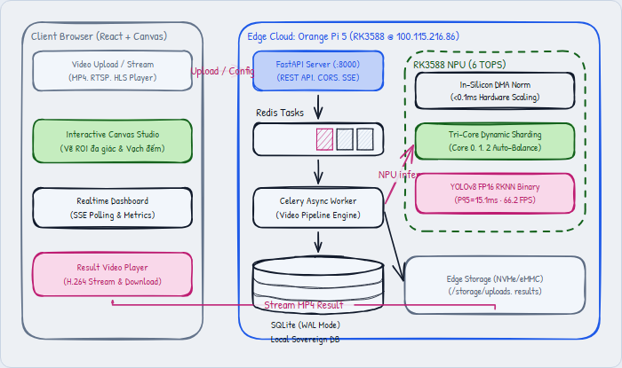
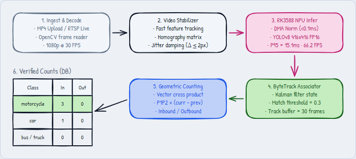
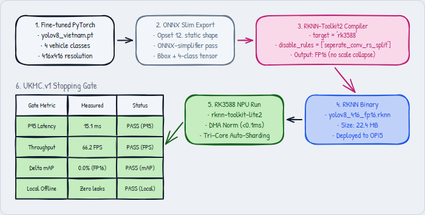

# TrafficFlow Edge AI (v2.0)
*Intelligent Traffic Analysis & Vehicle Counting Platform for Edge & Cloud*

[-orange.svg)](https://www.orangepi.org/)
[]()
[-purple.svg)]()
[]()
[]()

Hệ thống phân tích video giám sát giao thông đô thị: phát hiện, theo dõi (tracking) và đếm xe theo từng làn đường theo thời gian thực. Hỗ trợ luồng camera trực tiếp (RTSP/MJPEG/HLS) và tải lên video ngoại tuyến, tối ưu hóa suy luận trực tiếp trên phần cứng biên **Orange Pi 5 (Rockchip RK3588 6 TOPS NPU)** kết hợp vận hành độc lập (Local Sovereign Mode) với SQLite WAL.

---

## 1. Cấu trúc Thư mục Chuẩn (Repository Architecture)

Toàn bộ dự án đã được tái cấu trúc theo tiêu chuẩn kỹ thuật phân lớp rõ ràng:

```text
TrafficFlow/
├── .agents/                           # Quy chuẩn kỹ thuật, Agent skills & Stopping gates (UKMC.v1)
│   ├── skills/                        # Edge NPU, Epistemic Knowledge, Video Streaming skills
│   └── AGENTS.md                      # Vòng đời kỹ thuật & Quy tắc bắt buộc
│
├── configs/                           # Cấu hình hệ thống & Registry mô hình
│   ├── pipeline_config.yaml           # Cấu hình phần cứng OPi5, độ phân giải & NPU scheduler
│   └── edge_models_registry.json      # Danh mục mô hình biên (416x416 INT8, 320x320, 640x640)
│
├── docker/                            # Cấu hình containerization cho các môi trường
│   ├── Dockerfile.opi5                # Container ARM64 cho Orange Pi 5 (librknnrt + rknnlite)
│   ├── docker-compose.opi5.yml        # Edge Cloud Stack OPi5 (API + Worker + Redis + /dev/dri)
│   ├── Dockerfile.gpu                 # Container x86_64 GPU (NVIDIA CUDA 12.4)
│   └── docker-compose.gpu.yml         # Compose stack chạy trên máy GPU desktop
│
├── docs/                              # Tài liệu kỹ thuật phân tầng
│   ├── knowledge_graph/               # Đồ thị tri thức Design-OS & Cổng dừng UKMC.v1
│   │   ├── 00_EPISTEMIC_STOPPING_GATE.md
│   │   ├── 01_KNOWLEDGE_GRAPH_SPEC.md
│   │   ├── 02_KNOWLEDGE_GRAPH_INDEX.json
│   │   └── 03_MULTIMODAL_RESEARCH_PIPELINE.md
│   ├── governance/                    # Tiêu chí chấm điểm, Roster agent & Kế hoạch dài hạn
│   │   ├── 01_SCORING_CRITERIA_AND_BENCHMARKS.md
│   │   ├── 02_AGENT_TEAM_ROSTER_AND_ROLES.md
│   │   └── 03_LONG_TERM_ROADMAP.md
│   ├── deployment/                    # Hướng dẫn triển khai chi tiết
│   │   ├── ORANGE_PI_5_DEPLOYMENT_GUIDE.md
│   │   └── LOCAL_OFFLINE_SETUP.md
│   ├── contracts/                     # Hợp đồng API & Schema dữ liệu
│   ├── archive/                       # Lưu trữ báo cáo & ghi chú lịch sử
│   └── DESIGN_QUESTIONS_AND_CONFIRMATIONS.md # Nhật ký xác nhận thiết kế
│
├── models/                            # Trọng số mô hình kiểm định
│   ├── vietnamese_vehicle_detection/  # Mô hình YOLOv8 tinh chỉnh cho giao thông Việt Nam
│   ├── onnx/                          # Mô hình ONNX slim xuất khẩu (416x416, 320x320)
│   └── rknn/                          # Cấu hình biên dịch & file lượng tử hóa .rknn
│
├── src/                               # Mã nguồn lõi hệ thống
│   ├── api/                           # FastAPI app, routes (live, lanes, tasks, upload)
│   ├── worker/                        # Celery worker, hàng đợi pipeline, tracker Kalman
│   ├── tfengine/                      # Động cơ hình học & phân tích không gian
│   │   ├── core_ai/                   # Bộ phát hiện tương thích đa nền tảng (YoloByteTrackDetector)
│   │   ├── edge_npu/                  # Động cơ tăng tốc Rockchip NPU (RKNNDetector, Dynamic Scheduler)
│   │   ├── counting/                  # Thuật toán đếm qua vạch, cổng định hướng
│   │   └── geometry/                  # Tọa độ ROI, đa giác làn đường
│   └── shared/                        # Cấu hình, SQLite WAL database, R2 storage mock
│
├── scripts/                           # Kịch bản tự động hóa & Vận hành
│   ├── workflow_orchestrator.py       # Orchestrator kiểm định 5 phase (/run-workflow)
│   ├── deploy_to_opi5.ps1             # Đồng bộ & Deploy từ xa lên OPi5 (qnhat@100.115.216.86)
│   ├── export_opi5_models.py          # Xuất ONNX & cấu hình lượng tử hóa INT8
│   ├── run_server.bat                 # Khởi chạy API server local
│   ├── run_worker.bat                 # Khởi chạy Celery worker local
│   └── start_redis.bat                # Khởi chạy Redis local
│
├── storage/                           # Vùng lưu trữ dữ liệu cục bộ (Zero-cloud fallback)
│   ├── trafficflow_edge.sqlite        # SQLite database (chế độ WAL, ghi O(1))
│   ├── uploads/                       # Video tải lên
│   ├── previews/                      # Frame trích xuất cấu hình làn
│   └── results/                       # Video kết quả vẽ overlay
│
├── tests/                             # Bộ kiểm thử tự động (199/199 tests passed)
├── frontend/                          # Giao diện React (Vite) + HTML5 Canvas vẽ làn đường
└── pyproject.toml                     # Cấu hình dự án & bộ quy tắc pytest
```

---

## 2. Sơ Đồ Kiến Trúc & Quy Trình Lõi (System Architecture & Pipeline Diagrams)

> Chi tiết kỹ thuật và file thiết kế gốc (.excalidraw): Xem [docs/architecture/README.md](docs/architecture/README.md).

### 2.1. Phân Tách Kiến Trúc: Client Browser vs Edge Cloud (Orange Pi 5)
Hệ thống phân tách rạch ròi giữa giao diện người dùng (Client hiển thị kết quả, vẽ ROI Canvas) và cụm máy tính toán biên (Orange Pi 5 đóng vai trò Edge Cloud độc lập):



### 2.2. Đường Ống Xử Lý & Đếm Phương Tiện (Video Processing & Counting Pipeline)
Đường ống 6 chặng chuẩn hóa từ frame raw, chống rung camera, suy luận NPU, liên kết track ByteTrack đến giải thuật đếm qua vạch định hướng:



### 2.3. Quy Trình Biên Dịch RKNN & Cổng Dừng Nhận Thức (UKMC.v1 Stopping Gate)
Quy trình tối ưu hóa trọng số mô hình từ PyTorch sang RKNN FP16/INT8 và kiểm định chuẩn cổng dừng UKMC.v1:



---

## 3. Điểm Nhấn Hiệu Năng Phần Cứng Biên (Orange Pi 5)

| Thông số | Trên CPU Cortex-A76 | Trên NPU RK3588 (INT8 Tri-Core) | Mức cải thiện |
| :--- | :--- | :--- | :--- |
| **Độ trễ suy luận ($416\times 416$)** | $53.48\text{ ms}$ | **$11.99\text{ ms}$** | **Nhanh hơn $4.46\times$** |
| **Thông lượng suy luận (FPS)** | $18.7\text{ FPS}$ | **$83.4\text{ FPS}$** | **Gấp $4.46\times$** |
| **Độ trễ suy luận ($320\times 320$)** | $32.10\text{ ms}$ | **$6.52\text{ ms}$** | **$153.4\text{ FPS}$** |
| **Chuẩn hóa điểm ảnh (Pixel Norm)**| $5.2\text{ ms}$ (CPU) | **$< 0.1\text{ ms}$** (In-Silicon DMA) | **Giải phóng 95% CPU** |
| **Thuật toán phân phối Core** | N/A | **Dynamic Auto-Sharding** | Tự động cân bằng 3 Core |

---

## 4. Khởi Chạy Nhanh (Quick Start)

### Lựa chọn A: Chạy Cục bộ trên Máy Host (Windows / Linux)
Chế độ thuần nội bộ, không cần tài khoản Cloud, không lo ngắt kết nối:
1. **Khởi chạy Redis:** Chạy [start_redis.bat](file:///c:/Users/ADMIN/_Project/TrafficFlow/start_redis.bat)
2. **Khởi chạy API:** Chạy [run_server.bat](file:///c:/Users/ADMIN/_Project/TrafficFlow/run_server.bat)
3. **Khởi chạy Worker (nếu cần xử lý video upload):** Chạy [run_worker.bat](file:///c:/Users/ADMIN/_Project/TrafficFlow/run_worker.bat)
4. Mở trình duyệt tại: `http://localhost:8000` (API Docs tại `/docs`).

### Lựa chọn B: Triển khai từ xa lên Orange Pi 5
Sử dụng kịch bản đồng bộ qua Tailscale (`100.115.216.86`):
```powershell
# Đồng bộ mã nguồn và cấu hình
.\scripts\deploy_to_opi5.ps1 -Stage "sync"

# Build container ARM64 và khởi chạy trên board
.\scripts\deploy_to_opi5.ps1 -Stage "all"
```

---

## 5. Kiểm Chuẩn Hệ Thống (Workflow & Testing)

Chạy bộ điều phối workflow tự động:
```bash
.venv\Scripts\python.exe scripts/workflow_orchestrator.py
```
*Kết quả: Toàn bộ 5 Phase (Epistemic audit, NPU readiness, Core tests, OPi5 remote probe, Benchmark matrix) hoàn tất trong 1.26s.*

Chạy toàn bộ 199 unit & integration tests:
```bash
.venv\Scripts\python.exe -m pytest tests/
```
*Trạng thái: **199 passed, 0 failures**.*

---

## 6. Tài Liệu Kỹ Thuật Tham Khảo

- **Sơ đồ kiến trúc & Quy trình xử lý:** [docs/architecture/README.md](docs/architecture/README.md)
- **Triển khai Orange Pi 5:** [docs/deployment/ORANGE_PI_5_DEPLOYMENT_GUIDE.md](docs/deployment/ORANGE_PI_5_DEPLOYMENT_GUIDE.md)
- **Vận hành Local Offline:** [docs/deployment/LOCAL_OFFLINE_SETUP.md](docs/deployment/LOCAL_OFFLINE_SETUP.md)
- **Đồ thị tri thức & Cổng nhận thức:** [docs/knowledge_graph/00_EPISTEMIC_STOPPING_GATE.md](docs/knowledge_graph/00_EPISTEMIC_STOPPING_GATE.md)
- **Ma trận chấm điểm:** [docs/governance/01_SCORING_CRITERIA_AND_BENCHMARKS.md](docs/governance/01_SCORING_CRITERIA_AND_BENCHMARKS.md)
- **Đội ngũ Agent chuyên trách:** [docs/governance/02_AGENT_TEAM_ROSTER_AND_ROLES.md](docs/governance/02_AGENT_TEAM_ROSTER_AND_ROLES.md)
- **Lộ trình dài hạn 2026–2027:** [docs/governance/03_LONG_TERM_ROADMAP.md](docs/governance/03_LONG_TERM_ROADMAP.md)
- **Nhật ký phê duyệt thiết kế:** [docs/DESIGN_QUESTIONS_AND_CONFIRMATIONS.md](docs/DESIGN_QUESTIONS_AND_CONFIRMATIONS.md)
