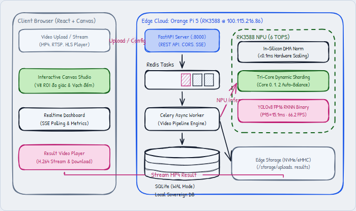
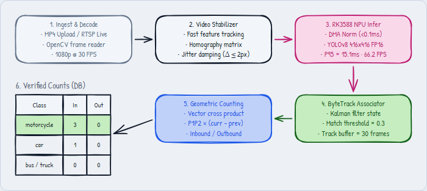
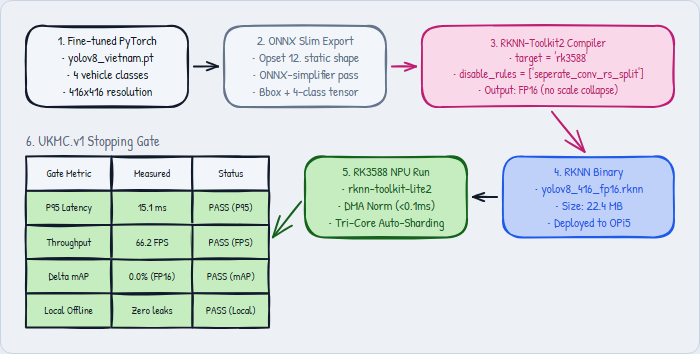

# Kiến Trúc Hệ Thống & Sơ Đồ Quy Trình (System Architecture & Diagrams)

Tài liệu này tổng hợp toàn bộ sơ đồ kiến trúc, quy trình xử lý thị giác máy tính và luồng lượng tử hóa biên của TrafficFlow Edge AI (v2.0). 
Mọi sơ đồ được thiết kế và render chuẩn từ hệ thống Excalidraw hand-drawn (`drawing-excalidraw-figures`).

---

## 1. Sơ Đồ Kiến Trúc Hệ Thống (System Architecture)

Sơ đồ phân tách rõ ràng giữa **Client Browser** (máy người dùng, hiển thị UI, vẽ ROI Canvas, stream video) và **Edge Cloud: Orange Pi 5** (RK3588 6 TOPS NPU, FastAPI, Celery Worker, Redis, SQLite WAL).

- **Source Excalidraw (Mở & Chỉnh sửa trực tiếp trên excalidraw.com):** [01-system-architecture.excalidraw](figures/01-system-architecture.excalidraw)
- **Vector SVG:** [01-system-architecture.svg](figures/01-system-architecture.svg)
- **Preview Dark Theme:** [01-system-architecture-dark.png](figures/01-system-architecture-dark.png)

---

## 2. Quy Trình Xử Lý Video & Đếm Xe (Video Processing & Counting Pipeline)

Quy trình 6 chặng từ nhận luồng video (Upload MP4 / RTSP Live), chống rung khung hình (Homography Stabilizer), suy luận NPU RK3588 (DMA Normalization + YOLOv8 FP16), theo dõi đối tượng (ByteTrack), thuật toán đếm xe qua vạch (Vector Cross Product) đến kết xuất H.264 và lưu trữ SQLite.

- **Source Excalidraw:** [02-video-counting-pipeline.excalidraw](figures/02-video-counting-pipeline.excalidraw)
- **Vector SVG:** [02-video-counting-pipeline.svg](figures/02-video-counting-pipeline.svg)
- **Preview Dark Theme:** [02-video-counting-pipeline-dark.png](figures/02-video-counting-pipeline-dark.png)

---

## 3. Quy Trình Biên Dịch RKNN & Cổng Dừng Nhận Thức (RKNN Compilation & UKMC.v1 Gate)

Luồng chuyển đổi mô hình từ PyTorch (`.pt`) $\to$ ONNX Slim $\to$ RKNN-Toolkit2 (kèm quy tắc op-fusing tùy chỉnh) $\to$ Thực thi NPU RK3588 (Tri-Core Auto-Sharding) $\to$ Xác thực cổng dừng UKMC.v1:

- **Source Excalidraw:** [03-rknn-edge-workflow.excalidraw](figures/03-rknn-edge-workflow.excalidraw)
- **Vector SVG:** [03-rknn-edge-workflow.svg](figures/03-rknn-edge-workflow.svg)
- **Preview Dark Theme:** [03-rknn-edge-workflow-dark.png](figures/03-rknn-edge-workflow-dark.png)
