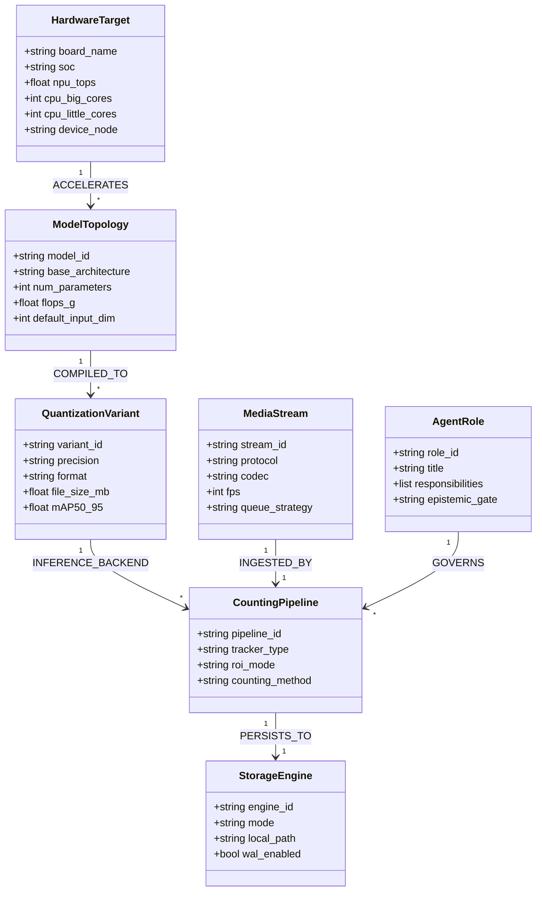

# TrafficFlow Domain Knowledge Graph Specification (v2.0)
*Reference Framework: Design-OS Universal Multimodal Knowledge Graph*

---

## 1. Ontology & Domain Model

The **TrafficFlow Knowledge Graph (TFKG)** organizes all concepts, physical hardware components, deep learning models, stream protocols, and architectural modules into an interconnected, queryable semantic network.



---

## 2. Node Schema Definitions

### 2.1 `HardwareNode`
Represents the target physical device executing the system.
- **Node ID**: `hw:orangepi5`
- **Properties**:
  - `name`: "Orange Pi 5"
  - `soc`: "Rockchip RK3588S (8-core: 4x Cortex-A76 @ 2.4GHz + 4x Cortex-A55 @ 1.8GHz)"
  - `npu_tops`: 6.0 (3x 2.0 TOPS independent execution cores)
  - `npu_device`: `/dev/dri/renderD129`
  - `memory_gb`: 8.0 LPDDR4x @ 2112MHz
  - `storage_type`: "NVMe PCIe 3.0 M.2 SSD"
  - `supported_frameworks`: `["rknn-toolkit-lite2", "librknnrt.so", "onnxruntime-aarch64"]`

### 2.2 `ModelNode`
Represents computer vision detection and classification models.
- **Node ID**: `model:yolov8n_vietnamese`
- **Properties**:
  - `name`: "Vietnamese Traffic YOLOv8n"
  - `task`: "Object Detection (Vehicles)"
  - `classes`: `["car", "motorcycle", "bus", "truck"]`
  - `weights_path`: "models/vietnamese_vehicle_detection/my_finetuned_yolov8.pt"
  - `input_dimensions`: `[320, 416, 640]`
  - `backbone`: "CSPDarknet"
  - `head_type`: "Decoupled Anchor-Free Detection Head"

### 2.3 `QuantizationVariantNode`
Represents concrete compiled binaries optimized for specific compute backends.
- **Node ID**: `variant:yolov8n_416_int8_rknn`
  - `format`: "RKNN"
  - `precision`: "INT8 QDQ (Selective Mixed Precision)"
  - `resolution`: `[416, 416]`
  - `mean_values`: `[[0, 0, 0]]`
  - `std_values`: `[[255, 255, 255]]`
  - `hardware_normalization`: true (in-silicon DMA execution)
  - `measured_latency_ms`: 11.99
  - `measured_fps`: 83.4
  - `mAP_50_95`: 0.508
- **Node ID**: `variant:yolov8n_640_fp16_onnx`
  - `format`: "ONNX"
  - `precision`: "FP16"
  - `resolution`: `[640, 640]`
  - `measured_latency_ms`: 53.48 (CPU fallback)

### 2.4 `MediaStreamNode`
Represents ingestion sources and streaming protocols.
- **Node ID**: `stream:rtsp_cctv`
  - `protocol`: "RTSP / RTP / H.264"
  - `buffering`: "Single-Slot Zero-Lag Frame Queue"
  - `resilience`: "Exponential backoff reconnect with packet loss smoothing"
- **Node ID**: `stream:video_upload_mp4`
  - `protocol`: "HTTP Multipart Chunked Upload"
  - `processing`: "Asynchronous Celery Worker / Local Queue"
  - `roi_filtering`: "crop_rect with polygon spatial containment"

### 2.5 `StorageNode`
Represents the data persistence layer under offline constraints.
- **Node ID**: `storage:local_edge_db`
  - `mode`: "Local Sovereign Fallback"
  - `primary_file`: "storage/local_db.json"
  - `journaling`: "Atomic rename & write-ahead log"
  - `offline_capable`: true
  - `sync_target`: "Cloud MongoDB (when online network resumes)"

---

## 3. Edge Definitions (Semantic Relationships)

| Source Node | Edge Type | Target Node | Semantics / Constraints |
| :--- | :--- | :--- | :--- |
| `model:yolov8n_vietnamese` | `QUANTIZED_TO` | `variant:yolov8n_416_int8_rknn` | INT8 quantization via on-device calibration |
| `variant:yolov8n_416_int8_rknn` | `ACCELERATED_BY` | `hw:orangepi5` | Direct DMA hardware execution on RK3588 NPU |
| `stream:rtsp_cctv` | `PIPELINED_INTO` | `pipeline:bytetrack_lane_counter` | Single-slot queue feeds live detector |
| `pipeline:bytetrack_lane_counter` | `WRITES_METRICS` | `storage:local_edge_db` | Real-time vehicle counts persisted locally |
| `agent:edge_npu_architect` | `VALIDATES_GATE` | `gate:ukmc_v1_precision` | Enforces $< 3\%$ mAP drop before deployment |

---

## 4. Query Patterns (Cypher / Graph Operations)

### Finding Optimal Variant for Streaming:
```cypher
MATCH (h:HardwareNode {name: "Orange Pi 5"})<-[:ACCELERATED_BY]-(v:QuantizationVariantNode)
WHERE v.measured_fps >= 60.0 AND v.mAP_50_95 >= 0.50
RETURN v.variant_id, v.format, v.resolution, v.measured_latency_ms, v.measured_fps
ORDER BY v.measured_fps DESC
```

### Trace Failures or Quantization Collapses:
```cypher
MATCH (m:ModelNode)-[:QUANTIZED_TO]->(v:QuantizationVariantNode)
WHERE (m.baseline_mAP - v.mAP_50_95) > 0.030
RETURN m.name, v.variant_id, v.precision, (m.baseline_mAP - v.mAP_50_95) AS accuracy_drop
```
